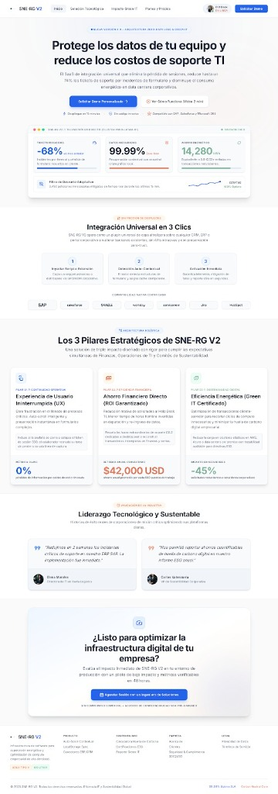
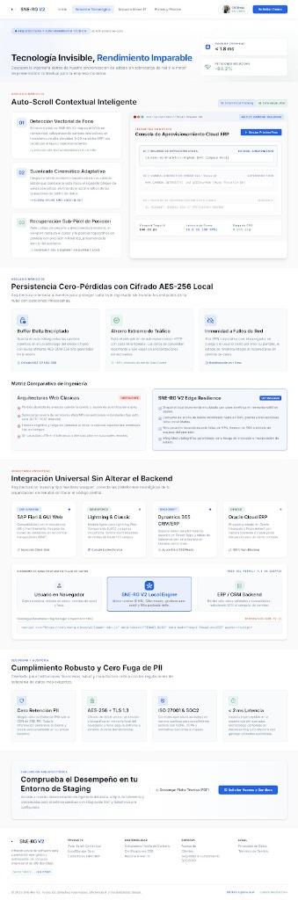
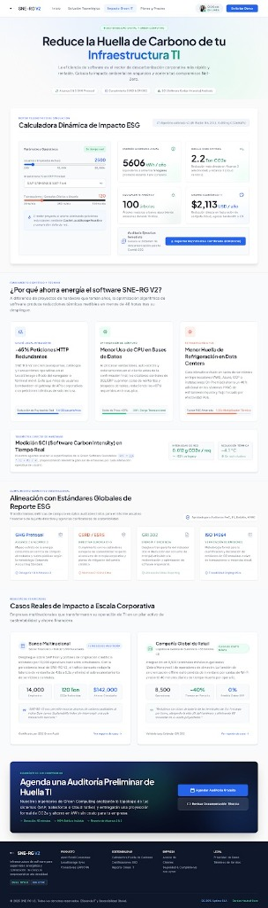
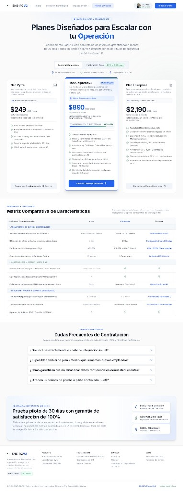

# EcoSync — SNE-RG V2

Repositorio de diseño y prototipado para **SNE-RG V2** (Sistema de Mensajería de Error Asistida y Recuperación Guiada).

---

## Vistas del Sistema (Mockups & UI)

### 1. Inicio / Landing Page
> *Protege los datos de tu equipo y reduce los costos de soporte TI.*

---

### 2. Solución Tecnológica
> *Tecnología Invisible, Rendimiento Imparable (Auto-Scroll contextual, persistencia local y resiliencia).*

---

### 3. Impacto Green IT
> *Reduce la Huella de Carbono de tu Infraestructura TI (Calculadora dinámica de impacto ESG).*

---

### 4. Planes y Precios
> *Planes diseñados para escalar con tu operación (Pyme, Corporativo y Enterprise).*

